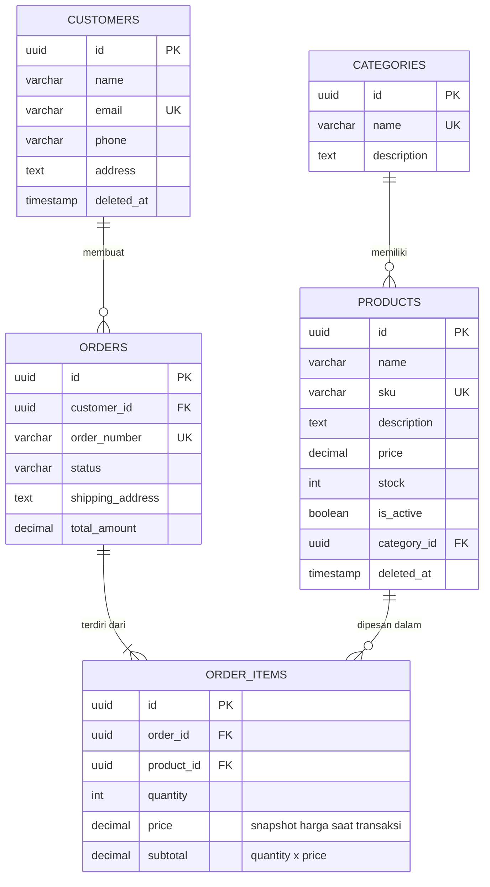

# E-commerce Management System API

## Kelompok 2
    Nama Anggota: Muhamad Ilyas
                : Gusti Rizqi Putra Hanif
                : Fauzy Adytyamaki Madhera
                : Muhammad Azfa Rizanta

Backend pengelolaan toko online: **produk, kategori, pelanggan, pesanan, dan detail pesanan**.
Dibangun dengan **NestJS + TypeORM + PostgreSQL** 

## Cara menjalankan

```bash
# 1. Install dependency
npm install

# 2. Jalankan PostgreSQL (pakai Docker) dan siapkan .env
docker compose up -d


# 3. Jalankan aplikasi (tabel dibuat otomatis saat NODE_ENV=development)
npm run start:dev

# 4. (opsional) Jalankan tes e2e - memakai database dari .env
npm run test:e2e
```

Server berjalan di `http://localhost:3000`.

## Struktur database (ERD)



| Relasi | Jenis | Perilaku saat induk dihapus |
|---|---|---|
| `categories` 1 — N `products` | OneToMany / ManyToOne | `category_id` produk menjadi `NULL` (`SET NULL`) |
| `customers` 1 — N `orders` | OneToMany / ManyToOne | Ditolak jika masih punya pesanan (`RESTRICT`); pelanggan memakai soft delete |
| `orders` 1 — N `order_items` | OneToMany / ManyToOne | Item ikut terhapus (`CASCADE`) |
| `products` 1 — N `order_items` | OneToMany / ManyToOne | Ditolak (`RESTRICT`); produk memakai soft delete sehingga riwayat tetap utuh |

**Atribut detail pesanan:** `quantity`, `price` (harga satuan **pada saat transaksi**, bukan harga katalog),
dan `subtotal`. Dengan snapshot ini, riwayat pesanan tidak berubah walaupun harga produk diubah kemudian.

## Endpoint

Semua response dibungkus format standar:

```json
{ "success": true, "message": "Berhasil", "statusCode": 200, "data": { } }
```

| Method | URL | Keterangan |
|---|---|---|
| GET / POST | `/categories` | Daftar / tambah kategori |
| GET / PUT / DELETE | `/categories/:id` | Detail (beserta produknya) / ubah / hapus |
| GET / POST | `/products` | Daftar (`?categoryId=`, `?search=`) / tambah produk |
| GET / PUT / DELETE | `/products/:id` | Detail / ubah / hapus (soft delete) |
| GET / POST | `/customers` | Daftar / tambah pelanggan |
| GET / PUT / DELETE | `/customers/:id` | Detail (beserta riwayat pesanan) / ubah / hapus (soft delete) |
| GET | `/orders` | Daftar pesanan (`?customerId=`, `?status=`) |
| POST | `/orders` | Buat pesanan |
| GET | `/orders/:id` | Detail pesanan + item + info produk + pelanggan |
| PUT | `/orders/:id` | Ganti item / ubah alamat kirim / ubah status |
| DELETE | `/orders/:id` | Hapus pesanan (hanya `pending` / `cancelled`) |

### Contoh: membuat pesanan

`POST /orders`

```json
{
  "customerId": "<uuid pelanggan>",
  "shippingAddress": "Jl. Merdeka No. 1",
  "items": [
    { "productId": "<uuid produk A>", "quantity": 3 },
    { "productId": "<uuid produk B>", "quantity": 2 }
  ]
}
```

`shippingAddress` opsional (default: alamat pelanggan). Harga dan total **dihitung server**; client tidak
bisa mengirim harga sendiri.

### Contoh: mengubah pesanan

`PUT /orders/:id` — salah satu dari:

```json
{ "status": "paid" }
{ "shippingAddress": "Alamat baru" }
{ "items": [{ "productId": "<uuid>", "quantity": 5 }] }
```

## Aturan bisnis pesanan

1. **Pesanan dibuat dalam satu transaksi database.** Jika ada satu item gagal (mis. stok kurang),
   tidak ada yang tersimpan dan stok tidak berubah.
2. **Validasi item:** minimal 1 item, `quantity` ≥ 1, produk tidak boleh dobel dalam satu pesanan,
   produk harus ada dan aktif (`is_active = true`).
3. **Stok:** stok produk berkurang saat pesanan dibuat. Jika stok tidak cukup → `409 Conflict`.
   Baris produk dikunci (`pessimistic_write`) sehingga dua pesanan bersamaan tidak bisa
   mengambil stok terakhir yang sama.
4. **Harga di-snapshot** ke `order_items.price`; `subtotal = quantity × price`;
   `orders.total_amount` = jumlah semua subtotal.
5. **Alur status:**

   ```
   pending ──► paid ──► shipped ──► completed
      │          │
      └──────────┴──► cancelled
   ```

   Perpindahan di luar alur ini ditolak (`409`). `completed` dan `cancelled` adalah status akhir.
6. **Pembatalan** (`cancelled`) mengembalikan stok semua item.
7. **Ubah item** hanya saat `pending` (stok lama dikembalikan, stok baru dikurangi).
   Item dan status tidak boleh diubah dalam satu permintaan.
8. **Ubah alamat kirim** hanya saat `pending` atau `paid`.
9. **Hapus pesanan** hanya untuk `pending` (stok dikembalikan) atau `cancelled`.
   Pesanan `paid`/`shipped`/`completed` adalah catatan transaksi dan tidak boleh dihapus.
10. **Hapus pelanggan** ditolak jika masih punya pesanan `pending`/`paid`/`shipped`.
11. Pesanan lama tetap menampilkan produk/pelanggan yang sudah di-soft delete.

## Struktur folder

```
src/
├── categories/    entity, dto, service, controller, module
├── products/      entity, dto, service, controller, module
├── customers/     entity, dto, service, controller, module
├── orders/        entity (Order, OrderItem), dto, service, controller, module
├── common/        decimal.transformer, defined-only
├── interceptors/  transform-response (format response standar)
└── middleware/    log-middleware
test/
└── ecommerce.e2e-spec.ts   25 skenario tes (CRUD + aturan bisnis + konkurensi)
```
